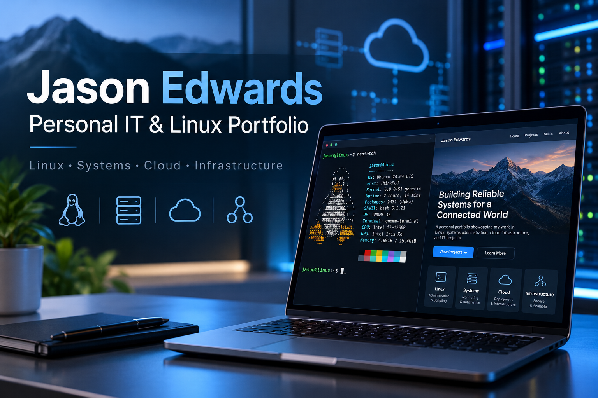

# Jason Edwards | IT & Linux Portfolio

## About

My personal IT and Linux engineering portfolio showcasing
systems administration, infrastructure engineering,
automation, networking, and technical projects.

Live Website: https://jasonpauledwards.com

## Technologies

- Ubuntu Linux
- Docker
- Caddy Web Server
- HTML5, CSS3, JavaScript
- HTTPS / TLS
- DNS and custom domain configuration
- Git and GitHub

## Infrastructure

The website is self-hosted on my Ubuntu Linux server
using Docker and Caddy.

Caddy handles HTTPS and serves the portfolio through
my custom domain.

## Features

- Responsive portfolio website
- Featured technical projects
- Professional experience
- Downloadable resumes
- Search engine optimization
- Custom domain and HTTPS

## Author

Jason Edwards

Website: https://jasonpauledwards.com

GitHub: https://github.com/cuzzaintit321

## License

All rights reserved unless otherwise stated.
